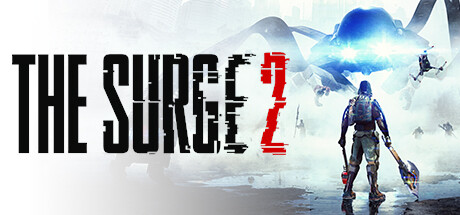

**The Surge 2 is the Soulslike action RPG set in a Jericho City quarantined after a nanobot apocalypse, where you target-lock specific enemy limbs to harvest components and build powerful exo-rig equipment. Features deep directional cutting mechanics.**

---

## 📖 About

The Surge 2 is the Soulslike action RPG set in a Jericho City quarantined after a nanobot apocalypse, where you target-lock specific enemy limbs to harvest components and build powerful exo-rig equipment. Features deep directional cutting mechanics.

## ⚠️ Problems Without Trainer

| Problem | Status |
|---------|--------|
| **Limb Targeting** — Cutting specific limbs in combat while avoiding heavy attacks requires practice | ✅ Solved |
| **Implant Slots** — Limited implant capacity forces painful gear trade-off decisions | ✅ Solved |
| **Boss Patterns** — Several bosses have lethal one-shot attacks that require memorization to avoid | ✅ Solved |
| **Resource Starvation** — Tech scrap drops insufficient for all desired upgrades without grinding | ✅ Solved |

## ✅ Solution

The **The Surge 2 Trainer** solves all these issues by giving you complete control over the game.

## 🎯 Full Feature List

- Unlimited Resources
- God Mode / Invincibility
- Instant Skill Cooldown
- One-Hit Kill
- Freeze Game Timer
- Unlock All Items & Achievements
- Custom Speed Multiplier
- Save State Anywhere

## 🚀 Quick Start

1. **Disable Windows Defender** temporarily (trainer may trigger false positive)
2. Download the trainer from the button above
3. Launch The Surge 2
4. Run the trainer as Administrator
5. Activate desired cheats with hotkeys

## 💎 Free vs Paid

| Feature | Free | Pro |
|---------|------|-----|
| Basic God Mode | ✅ | ✅ |
| Unlimited Resources | ✅ | ✅ |
| All Advanced Cheats | ❌ | ✅ |
| Auto-Updates | ❌ | ✅ |
| Priority Support | ❌ | ✅ |

## 💻 Requirements

- Windows 10/11 (64-bit)
- The Surge 2 (any version)
- .NET Framework 4.8+
- DirectX 11+

## 🍎 macOS

macOS users can use our alternative tool:

## ⚖️ Legal

This trainer is for educational and single-player use only. Use responsibly.

---

